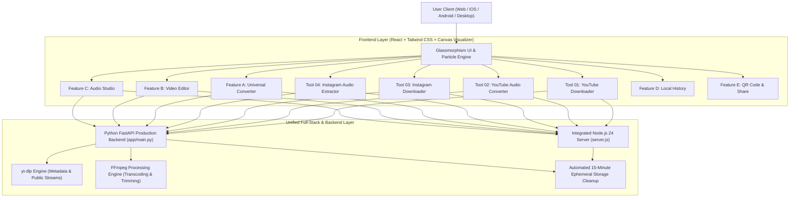

# ⚡ GSK MEDIAVERSE – All-in-One Video & Audio Studio

> **"Everything Media. One Powerful Studio."**  
> *Brand Identity: GSK MEDIAVERSE – One Platform. Endless Media Possibilities.*  
> Built by **Saikiran Gorle (GSK)**

[](#)
[](#)
[](#)
[](#)
[](#)

---

## 🌟 Overview

**GSK MEDIAVERSE** is a high-performance, responsive media downloader, converter, and editing studio designed with a cyber-luxe, futuristic aesthetic. Built with deep obsidian backgrounds, electric violet and neon cyan glows, glassmorphism cards, animated waveforms, and interactive particle canvases, it delivers a commercial SaaS experience without ads, paywalls, or artificial limitations.

---

## 🛠️ System Architecture



---

## 🚀 Core Features

### 1. Four Core Downloader & Extractor Tools
- **TOOL 01 – YouTube Video Downloader**:
  - URL format validation (`watch?v=...`, `youtu.be/...`, `shorts/...`)
  - Rich metadata extraction: Thumbnail, Title, Channel, Duration, View count
  - Multi-resolution selector: `1080p Full HD (60fps)`, `720p HD`, `480p`, `360p`, `240p`, `144p`
  - Animated progress indicator with streaming stages
  - Direct browser download save with Gallery integration tip
- **TOOL 02 – YouTube Audio Converter**:
  - Converts authorized YouTube media to `MP3`, `WAV`, `AAC`, and `M4A`
  - Bitrate selection: `320 kbps (Extreme)`, `256 kbps`, `192 kbps`, `128 kbps`
  - Built-in Interactive Audio Player with dynamic audio wave visualizer, play/pause, seekbar, and volume controls
- **TOOL 03 – Instagram Video Downloader**:
  - Instagram Reels, Videos, and Posts URL parser
  - Poster preview with author attribution
  - Download in original 1080p HD or compressed 720p mobile quality
- **TOOL 04 – Instagram Audio Extractor**:
  - Extracts background sound and trending audio from Instagram Reels
  - Export to `MP3`, `WAV`, or `M4A`
  - Audio preview player with waveform

### 2. Extra Premium Utilities
- **A. Universal Media Converter**:
  - Drag-and-drop file upload (MP4, MOV, WEBM, MKV, MP3, WAV, AAC, M4A)
  - Transcoding presets: MP4 to MP3, MP4 to WAV, WAV to MP3, Video to animated GIF (with customizable 10, 15, 24 FPS)
- **B. Video Editor**:
  - Interactive dual-handle timestamp slider for Start and End times
  - Millisecond precision
  - Real-time video preview before exporting
  - Trim video or extract audio segment
- **C. Audio Studio**:
  - Real-time Web Audio API frequency spectrum canvas
  - Playback speed adjustment: `0.5x`, `1.0x`, `1.25x`, `1.5x`, `2.0x`
  - Volume booster & dynamic tone synthesizer
- **D. Download History**:
  - Locally stored in browser `localStorage`
  - Re-download files, view size, format, date, or clear history
- **E. QR Code & Device Share**:
  - Real-time QR Code generation for any media URL
  - Native Web Share API integration for one-tap WhatsApp, Telegram, or AirDrop sharing
  - One-click link copying

---

## 💻 Quick Start & Local Execution

### Option 1: Instant One-Click Launcher on Windows (Zero Setup Required)
You can launch the entire platform immediately:
1. Double-click `start.bat` in the project root.
2. It automatically sets the environment, boots the unified server on port `3000`, and opens your default browser at `http://localhost:3000`.

Or from PowerShell:
```powershell
.\start.ps1
```

---

### Option 2: Running with Python FastAPI Backend
If you have Python 3.10+ and FFmpeg installed on your machine:

1. **Navigate to the backend directory**:
   ```bash
   cd backend
   ```
2. **Create a virtual environment & install requirements**:
   ```bash
   python -m venv venv
   # On Windows:
   .\venv\Scripts\activate
   # On Linux/macOS:
   source venv/bin/activate

   pip install -r requirements.txt
   ```
3. **Launch the FastAPI Server**:
   ```bash
   python run.py
   # Or using uvicorn:
   uvicorn app.main:app --host 0.0.0.0 --port 8000 --reload
   ```
4. Access the interactive Swagger API documentation at:  
   `http://localhost:8000/docs`

---

### Option 3: Docker Deployment
To run both backend and dependencies in an isolated container:
```bash
cd backend
docker build -t gsk-mediaverse-api .
docker run -p 8000:8000 --name mediaverse gsk-mediaverse-api
```

---

## ☁️ Render Hosting Deployment

This project includes a ready-to-use Render Blueprint configuration (`render.yaml`).

### Deploying to Render via GitHub:
1. Push this repository to your GitHub account (instructions below).
2. Go to your [Render Dashboard](https://dashboard.render.com/).
3. Click **New +** and select **Blueprint**.
4. Connect your `gsk-mediaverse` GitHub repository.
5. Render will automatically detect `render.yaml` and configure:
   - **Service Name**: `gsk-mediaverse-api` (Python Web Service)
   - **Environment Variables**: Automatically configured
   - **Start Command**: `python backend/run.py`
6. Click **Apply** to deploy live!

---

## 🐙 GitHub Push Instructions

To push this complete project to your GitHub account:

```bash
# 1. Initialize Git repository
git init

# 2. Add all project files
git add .

# 3. Create initial commit
git commit -m "Initial commit: GSK MEDIAVERSE All-in-One Video & Audio Studio"

# 4. Set default branch to main
git branch -M main

# 5. Add your GitHub remote repository (replace with your repo URL)
git remote add origin https://github.com/<YOUR-USERNAME>/gsk-mediaverse.git

# 6. Push to GitHub
git push -u origin main
```

---

## 📡 REST API Reference

| Method | Endpoint | Description |
| :--- | :--- | :--- |
| `GET` | `/api/health` | Service health status and feature flags |
| `POST` | `/api/media/info` | Validates URL and returns media metadata and format options |
| `POST` | `/api/media/download` | Initiates authorized processing and generates download stream |
| `GET` | `/api/media/stream/{file_name}` | Streams binary media file with `Content-Disposition` attachment |
| `POST` | `/api/convert/file` | Converts user-uploaded file (MP4, WAV, GIF, MP3) |
| `POST` | `/api/editor/trim` | Trims video or extracts audio segment based on start/end timestamps |

### Example Metadata Request:
```bash
curl -X POST http://localhost:3000/api/media/info \
  -H "Content-Type: application/json" \
  -d '{"url": "https://www.youtube.com/watch?v=dQw4w9WgXcQ"}'
```

---

## 🔒 Legal & Terms Compliance

- **Fair-Use & Public Access Only**: GSK MEDIAVERSE operates under strict compliance with platform terms of service.
- **No DRM Bypass**: This tool does not bypass DRM (Widevine, PlayReady), encrypted streams, private account credentials, or access restrictions.
- **Privacy First**: User uploaded files and temporary streams are stored ephemerally and automatically cleaned after 15 to 30 minutes.

---

## 👨‍💻 Author

**Saikiran Gorle (GSK)**  
*GSK MEDIAVERSE – One Platform. Endless Media Possibilities.*
